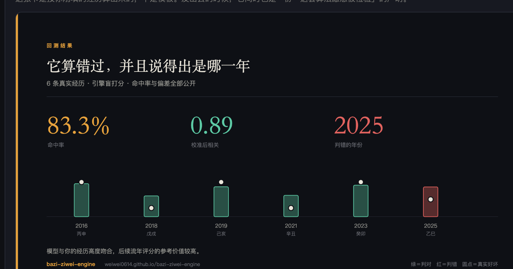
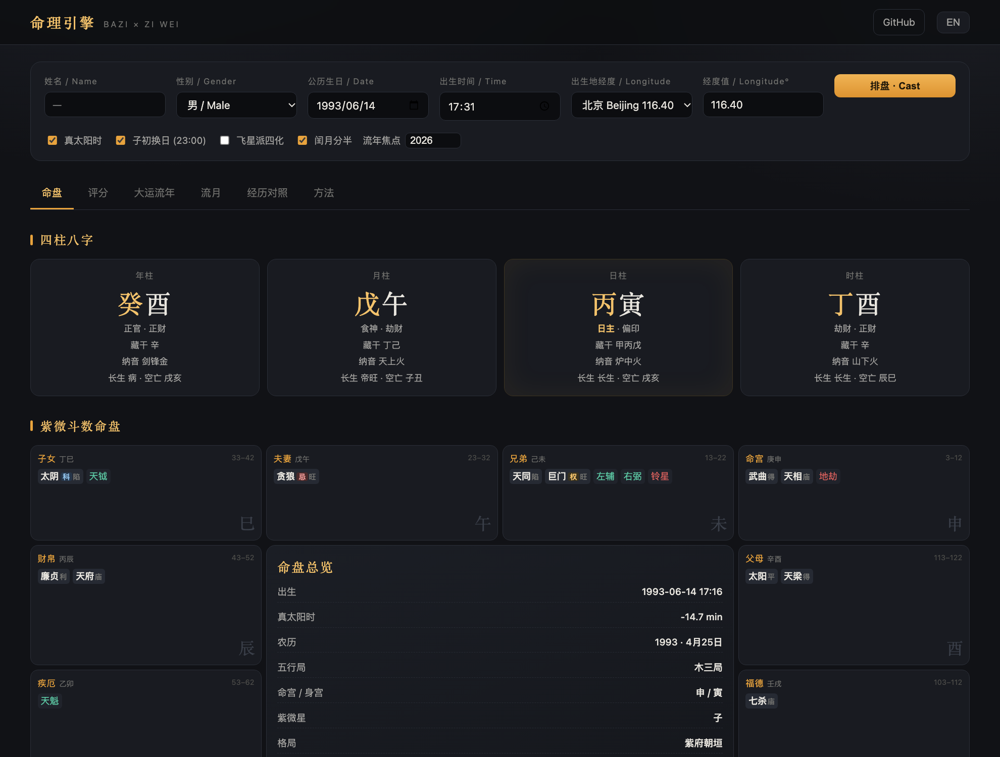
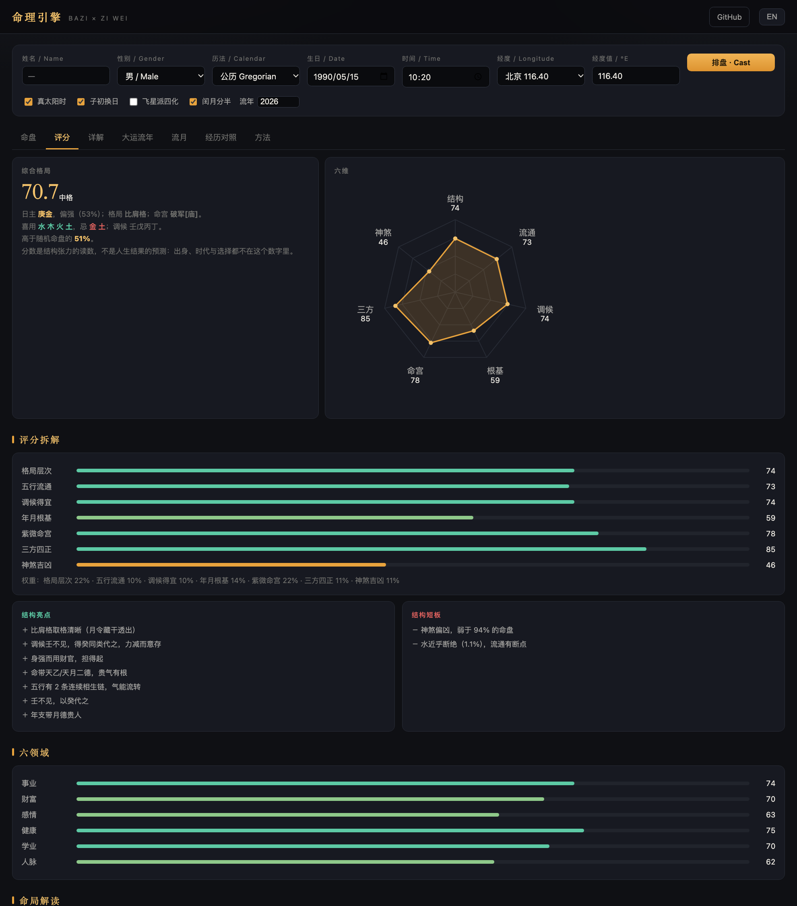
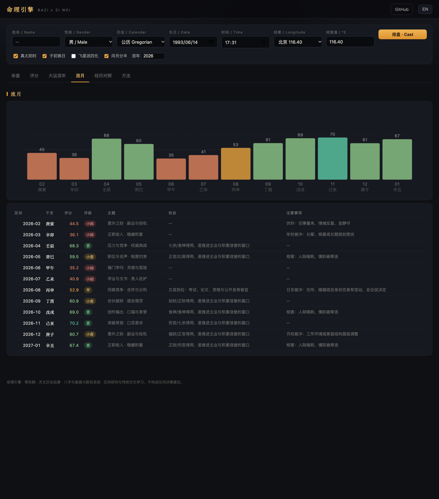

# bazi-ziwei-engine

**八字（四柱）与紫微斗数双系统交叉验证的排盘与运势引擎 —— 零依赖、天文历法自算，并且会用你的真实经历给自己打分。**

> [English](README.md) | 简体中文

<p align="center">
  <a href="https://weiwei0614.github.io/bazi-ziwei-engine/"></a>
  
  
  
  
</p>



<sub>这张卡是按你自己填的经历算出来的，不是模板。换成你的年份，数字会变——**包括判错的那一年**。</sub>



---

## 为什么再写一个

> **格位与强度是两个数。** 传统判「上格」看的是——格成不成、什么破了它、有没有救应，而不是把七个维度平均。
> 从格可以身弱而格高，身强之造也可以格低。把两者混成一个平均分，是这类工具最常见的错。
>
> **每个专业词都能解释。** 126 条术语（天干地支、十神、格局、45 颗神煞、紫微十二宫、六十四卦）中英双语，全站自动标注，悬停或点击即出。

开源的中文命理项目，绝大多数只做**八字**或只做**紫微**，而且做到「把盘画出来」就停了。
这个项目的三条主张，恰好是别人略过的部分：

1. **历法不查表。** 节气由截断 VSOP87 级数（含章动、光行差、FK5 修正）算出太阳视黄经，
   再用牛顿迭代求 15° 整数倍的时刻；朔望用 Meeus 第 49 章。两百年的查表数据是别人的
   判断结果，算出来的星历是一条你可以自己复核的推理链。
2. **两个系统，一份结论。** 八字给五行结构，紫微给十二宫。两套各算各的，再加权合并——
   一个说法要在两套体系里都站得住，才算数。
3. **用你的真实经历反过来检验模型。** 别的工具只告诉你「将会怎样」。这个先问你
   「已经怎样了」，把它自己算过的那些年逐条比对，给出吻合率与相关系数，
   **并且在你和它不一致时重新拟合权重**。

---

## 快速开始

```bash
git clone https://github.com/WEIWEI0614/bazi-ziwei-engine.git
cd bazi-ziwei

python -m mingli chart --date 1993-06-14 --time 17:31 --gender male --lon 116.65
python -m mingli year  2027 --date 1993-06-14 --time 17:31 --gender male
python -m mingli month 2027 --date 1993-06-14 --time 17:31 --gender male
python -m mingli md    --date 1993-06-14 --time 17:31 --gender male -o report.md
python -m mingli serve            # http://127.0.0.1:8788
```

不用 `pip install`、不用虚拟环境、不联网。Python 3.9+，只用标准库。

浏览器版是同一套引擎的原样移植：

```bash
cd docs && python3 -m http.server 8000     # http://127.0.0.1:8000
```

或直接打开在线演示：**https://weiwei0614.github.io/bazi-ziwei-engine/**

---

## 包成 Agent Skill 或 MCP

同一套引擎打包了两次，让 AI 助手直接调用，而不是自己瞎推排盘。

**做成 Agent Skill。** 仓库根目录的 `SKILL.md` 遵循 Agent Skills 规范，克隆到 skills 目录即可：

```bash
git clone https://github.com/WEIWEI0614/bazi-ziwei-engine.git ~/.claude/skills/bazi-ziwei
```

技能里明确规定：**先跑回测、再解释**，而且每一个结论都要指到具体的干支、十神或宫位。这一条是为了对付模型「说得很像但拿不出依据」的通病。

**做成 MCP server。** `mcp_server.py` 走 stdio 的 JSON-RPC，只用标准库：

```json
{"mcpServers": {"bazi-ziwei": {
  "command": "python",
  "args": ["/绝对路径/bazi-ziwei-engine/mcp_server.py"]}}}
```

| 工具 | 返回 |
|---|---|
| `chart` | 四柱、格局、成格/破格/救应审计、五行占比、45 神煞、紫微十二宫 |
| `annual` | 流年与流月分数，附产生这个分数的每一项成分 |
| `backtest` | 命中率、Pearson、判错的年份、重拟合后的权重 |
| `synastry` | 两张盘、六种关系 |

## 八字紫微交叉验证

这个名字里的「交叉」不是修辞。大多数工具要么只排八字、要么只排紫微，两者的结论即使打架也没人管。这里做的是：

- **八字判结构**（格成不成、什么破了它、有没有救应），**紫微判宫位**（命、财、官、迁的星曜与四化）；
- 两边的判断**分别成段列出**，不取平均——合成一个总分是最省事也最骗人的做法；
- **结论不一致时如实写出来**。比如八字说事业强于财帛、紫微说财帛宫更旺，报告会并列呈现，让读者自己判断哪一边更贴近自己的经历；
- 判完之后，用**你的真实经历**（年份 + 发生了什么 + 好坏 −3…+3）回头检验它，给出命中率、相关系数，以及**它算错的年份**。

这也是「八字紫微交叉验证」与「八字紫微都算一遍」的区别：前者要的是互相印证或互相证伪，后者只是把两个排盘软件并排打开。

## 它能算出什么

| 层 | 输出 |
|---|---|
| **历法** | 太阳视黄经（截断 VSOP87）、二十四节气（精确到秒）、朔望（Meeus 49）、按「无中气置闰」的农历、真太阳时（经度差 + 均时差） |
| **四柱** | 年月日时四柱、十神、藏干、纳音、十二长生、旬空、月令旺相休囚死、五行量化占比、日主强弱、格局、调候、**45 颗神煞（分吉/中/凶，每颗带「落宫 + 依据」）**、全部合冲刑害破 |
| **运程** | 大运顺逆与起运（三日折一年）、十步大运、流年、按十二节排的流月 |
| **紫微** | 十二宫、五行局、十四主星含七级亮度、六吉六煞、**38 杂曜**、**长生/博士/将前/岁前四套十二神**、大限与小限、命主身主、斗君、生年四化（三合与飞星两表）、宫干自化、流年命宫 |
| **评分** | 七维合成总分 0-100 与格位；事业/财富/感情/健康/学业/人脉六领域分，且每一项的成分都摊开 |
| **时间轴** | 逐年评分 + 主题 + 注意事项 + 机会；逐月同构，幅度收窄 |
| **经历对照** | 吻合率、Pearson 相关系数、岭回归重拟合权重、逐条列出不吻合的年份 |
| **格位判定（新）** | 八字逐条审计「成格 / 破格 / 救应」，紫微按古法「吉星加会且无煞方合此格」判 16 个吉格，再合成格位 |
| **八派并列（新）** | 子平格局、调候、新派量化、盲派宾主做功、纳音神煞、紫微三合、紫微飞星、河洛宫位卦象 |
| **卦象（新）** | 梅花易数时间起卦：本卦 / 互卦 / 变卦、动爻、体用生克，六十四卦齐备 |
| **合盘（新）** | 双盘六种关系（夫妻/恋人/朋友/合伙/亲子/上下级），六层加权，逐条给理由 |
| **日主形象（新）** | 20 张插画（十天干 × 男女），绿幕生成后抠图，按日主自动匹配 |
| **大模型问答（新）** | 自带 Key（任意 OpenAI 兼容接口），命盘摘要自动拼进提示词，Key 只留在浏览器 |
| **中英严格分版（新）** | 中文版不出现英文，英文版不出现汉字——包括占位符、悬浮提示与图表标签 |
| **详解** | 中英双语的逐盘解读：格局与用神、十神分布、四柱宫位、神煞与刑冲，以及紫微十二宫逐宫论述 |




---

## 精度：实际验过什么

这里没有一个数字是凭记忆断言的。用两个独立实现当基准，每一处不一致都追到了根因。

| 检查项 | 样本 | 结果 |
|---|---|---|
| 节气 vs `lunar_python` | 24 节气 × 13 个年份，1900-2100 | 最大偏差 **30 秒**，日期全部一致 |
| 农历 vs `lunar_python` | 4,008 个日期 × 4 个时刻 | 44 处不一致 = **0.27 %**，全部集中在两个「朔在午夜前后数秒」的临界日 |
| 四柱 vs `lunar_python` | 3,000 个随机时刻，1902-2098 | 年/月/日/时 **零误差** |
| 紫微 vs `iztro`（命宫/五行局/宫干） | 700 张盘 | **零误差** |
| 紫微 vs `iztro`（十四主星 + 十三辅煞） | 700 张盘 | **1 张**差一颗主星（朔日临界） |
| 紫微 vs `iztro`（38 杂曜） | 700 张盘 | **1 张**（同一个临界盘） |
| 紫微 vs `iztro`（四套十二神 / 小限 / 大限） | 700 张盘 | **零误差** |
| 神煞 45 颗 JS vs Python | 30 张盘 | 名称、落宫、吉凶完全一致 |
| 浏览器 JS vs Python | 60 张盘、15 组字段 | 完全一致，差异仅来自四舍五入（±0.1） |

**两个值得单独记下来的坑**（很多项目栽在这）：

* **月长必须按「日」判定，不能按「时刻」判定。** 2025 年 8 月 23 日，朔在 14:06、
  处暑在 04:33。按时刻比较，处暑算进上个月，闰月就整体后移一格——闰六月会变成闰七月。
  国标 GB/T 33661-2017 的做法是比较「日」。
* **起紫微诀不是「一律逆退」。** 诀曰「商数宫前走……借数为偶顺行、为奇逆退」。
  写成「永远逆退借数」，会有一半的盘整体错开四宫，而且看上去还挺像回事。

自己跑一遍：

```bash
python -m unittest discover -s tests -v      # 19 个测试，零依赖
node tools/parity.js cases.json out.json     # 可选的 JS/Python 一致性夹具
```

---

## 它真的能预测吗？

不能。至少现在不能，而且这个数字应该放在人看得见的地方。

[MingLi-Bench](https://github.com/DestinyLinker/MingLi-Bench) 收了 160 道来自「全球算命师大赛」（2022–2025）的选择题：每道给出出生时刻，问某年发生了什么事，或者某事发生在哪一年。这是目前唯一有标准答案的公开题库——"引擎对不对"有答案，不是各说各话。

```bash
python tools/bench_mingli.py
```

160 道里，本引擎能判定的有 66 道（其余问外貌、学历、性格，本引擎不做）。**答对 7 道，10.6%；随机是 25%。**

这个数字有两种读法：

- **诚实的那种**：流年分数没有可测的预测力。真实答案是负面事件的年份平均 53.7 分，正面事件 54.2 分，而这把尺子的标准差是 10.5——0.5 分的差是噪音。
- **宽容的那种**：这道题问的是"从命盘读出一件具体的事"，而任何规则引擎都做不到。选项文字（"因长期食药，导致健康出问题"）要靠关键词映射到生活领域，误差主要产生在这一步。这个领域上游的开源项目也都不做这件事。

结论：分数是**同一张盘内给年份排序的尺子**，不是预报。界面因此优先显示分位数而不是原始分——分位是唯一能直接说出口的部分，并且把「权重是自定的」那几项标了出来。

---

## 覆盖的流派

这个领域没有唯一正确答案。凡流派有分歧的地方，一律做成选项并写明出处，
绝不在后台悄悄取平均。

| 领域 | 已实现 | 说明 |
|---|---|---|
| 子平格局 | 月令取格、透干优先、建禄/月刃、从格、专旺 | `structure.basis` 直接写出用了哪条取格规则 |
| 调候 | 《穷通宝鉴》120 条，分别标出「已见 / 缺」 | 各版本有出入，表中注明采徐乐吾注本 |
| 旺衰 | 干支加权（月令 24 %）× 旺相休囚死，另加三合三会 | 权重写在代码里，不藏在参数后面 |
| 神煞 | 天乙/文昌/驿马/桃花/华盖/将星/羊刃/禄/空亡/魁罡 | 皆可溯源，不自创星曜 |
| 紫微安星 | 三合派（与 iztro 逐星一致） | 逐星验证过 |
| 四化 | 三合派 / 中州派（默认）**与** 飞星派 | 庚、壬两干取法不同；`--feixing` 切换 |
| 闰月 | 十五分半（默认）/ 整月算本月 / 算下月 | `--leap-same` 取整月 |
| 换日 | 子初 23:00（默认）/ 子正 00:00 | `--zi-mid` |
| 真太阳时 | 经度差 + 均时差，默认开启 | `--no-true-solar` 关闭 |

---

## 流年是怎么打分的

顺序依《子平真诠》：先定用神，再论十神，后看刑冲会合，最后叠大运。

1. **用神专求月令。** 强弱只定方向（身强宜泄宜克，身弱宜生宜扶），格局定先后。
   结果是一到两个喜用五行、一到两个忌神，**其余为闲神，闲神年份不作吉凶论**。
   「平年」就是这么来的。早前的版本把五个五行全部分了类，于是每一年都有话说，
   读数在两端来回跳——不是命在摇摆，是刻度只有两档。
2. **十神吉凶随格局变。** 正官格见伤官是破格，伤官格见伤官却是驾御。
   一张固定的吉神表，在这两条里必然错一条。
3. **冲不等于凶。** 冲去忌神是去病，冲伤用神才是凶，冲闲神只是动。
   合也一样：合住忌神是好事，合住用神是绊住。
4. **大运定基调，流年只作触发。** 天干四成、地支六成；大运十神若为格局所忌，
   另计破格之罚。

分数压缩在 32–94，分档按实际分布的分位数定，不按整数拍。旧阈值 80/68/58/46
会把七成年份塞进「平」和「小吉」，整条线看起来是平的——不是人生平，是尺子坏了。

---

## 经历对照为什么重要

所有命理工具在构造上都不可反驳。这一个至少局部可反驳：

```bash
cat > events.json <<'JSON'
[
  {"year": 2016, "kind": "study",  "impact":  2, "note": "出国读研"},
  {"year": 2020, "kind": "career", "impact": -1},
  {"year": 2023, "kind": "career", "impact": -2, "note": "最难的一年"},
  {"year": 2025, "kind": "career", "impact":  1}
]
JSON
python -m mingli chart --date 1993-06-14 --time 17:31 --gender male --events events.json
```

引擎会盲着把这些年重新打一遍分，然后给出：

* **吻合率** —— 分数的高低是否与你的评价同号，
* **Pearson 相关系数** —— 幅度是否也跟着走，
* **重拟合权重** —— 对四个成分（用神 / 冲合 / 神煞 / 大运）做岭回归，
* **不吻合清单** —— 具体哪几年错了，以及它当时依赖的哪条刑冲合害。

吻合率低，它会直说，并列出该先核查的三件事（出生时间、立春与正月初一的年界、非命理变量）。
**一个允许自己输的模型，比一个不可能输的模型更可信。**

---

## 结构

```
mingli/
  calendar/astro.py     儒略日、ΔT、章动、VSOP87 太阳、节气、朔望、均时差
  calendar/lunar.py     以「岁」为单位的农历、五柱
  calendar/ganzhi.py    全部传统查表（藏干、纳音、神煞、刑冲合害……）
  bazi/chart.py         排盘 + 五行加权 + 格局 + 调候 + 相互作用
  bazi/luck.py          大运、流年、流月打分
  ziwei/chart.py        完整安星（已与 iztro 逐星核对）
  ziwei/analysis.py     三方四正、格局、大限、流年
  reading.py            总评分、六领域、经历对照与校准
  cli.py                chart / year / month / md / json / serve
web/                    index.html + app.js + engine.js + data.js（浏览器版）
docs/                   web/ 的发布副本，用于 GitHub Pages
tools/gen_js_data.py    由 Python 端生成 data.js —— 这是两端不漂移的原因
tools/parity.js         JS 与 Python 的逐字段比对
tools/check_lang.py     渲染中英两版，任一侧漏出对方文字就报错
tests/                  64 个单元测试，无第三方依赖
```

`web/data.js` 是**生成的**，从不手写：VSOP 系数、藏干、纳音、调候表、星曜亮度、四化表，
全部由 `tools/gen_js_data.py` 从 Python 模块导出。两端因此不可能各说各话。

界面在结构上就是单语的：数据层保留中文原名（干支、神煞、星名），渲染层负责映射，
所以 `?lang=en` 拿不到中文串，`?lang=zh` 也拿不到英文标签。这条由真浏览器验，不靠 grep：

```bash
python tools/check_lang.py        # 有任何残留就退出码 1；加 --show 看全量
```

---

## 局限（信任何一个数字之前请先读）

1. 2050 年之后的 ΔT 只是**预测**，远期节气时刻可能有数十秒误差。
2. 若朔恰在地方时午夜前后数秒，农历日可能差一天（约三十年一遇；1900-2100 之间有两例）。
3. 权重是启发式的：声明清楚、可测试，但不是推导出来的——这正是「经历对照」存在的理由。
4. 这是一套描述**倾向**的结构模型，**不预测具体事件**，也不构成医疗、财务或法律建议。
5. 紫微的年干支采用农历年（正月初一），是传统做法；部分软件用立春，
   会让出生在这两个日期之间的人整盘不同。

---

## 欢迎什么样的贡献

最有价值的贡献是**反例**：某张盘按另一条古法应取另一个格局、某个流派的表格与此不同、
某个日期的农历与官方万年历不符。请带上输入、期望输出与出处开 issue。
**请不要在没有出处的情况下增加星曜或规则**——这个项目的全部价值，就在于每条论断都能追回到
一本书或一段算法。

## 许可

MIT。所引古籍（《渊海子平》《穷通宝鉴》《紫微斗数全书》）均属公有领域。
